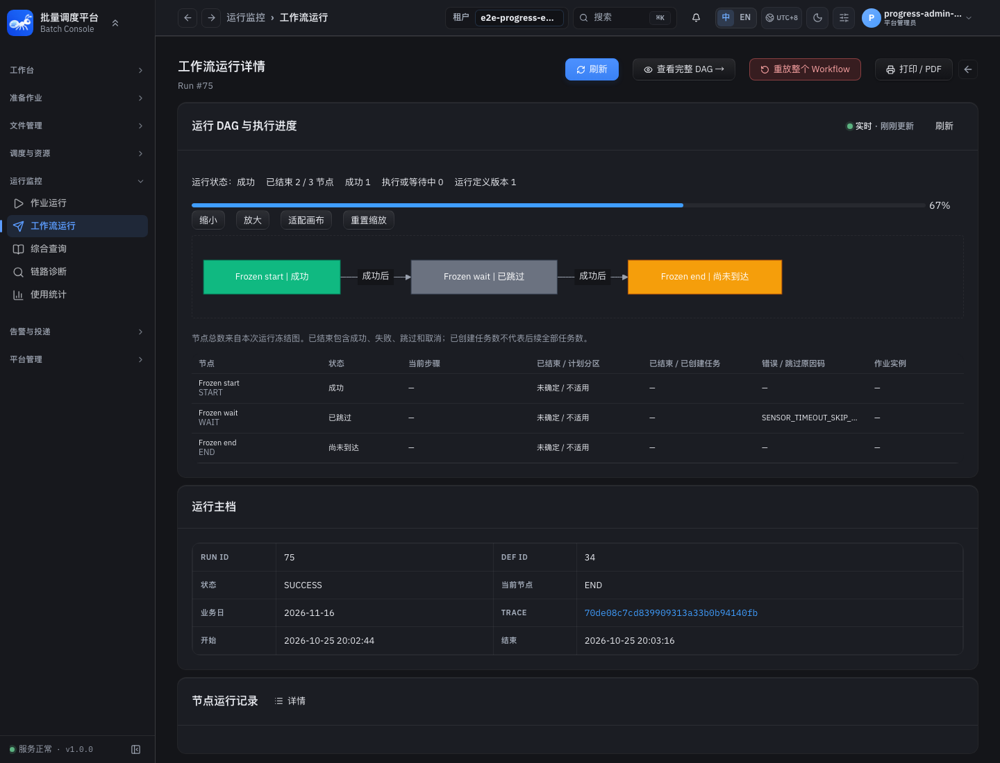
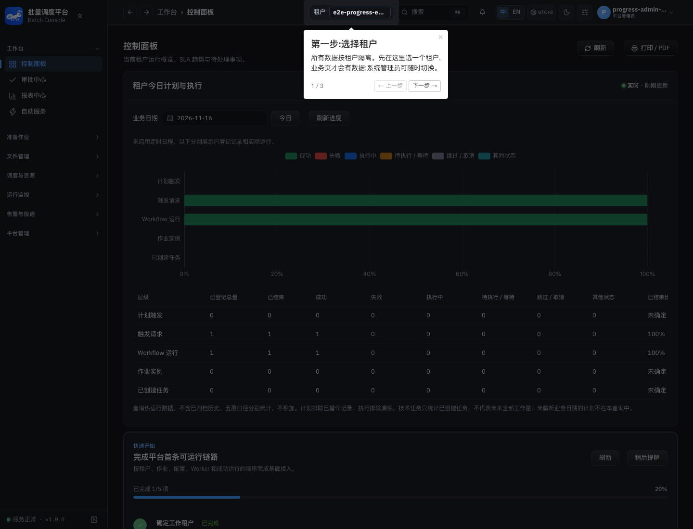

# WDI 运行图与租户业务日进度联调快照

## 范围与基线

本批推进 [17项实施矩阵](../engineering/backend-capability-alignment-plan-2026-10-25.md) 中P00/P02/P03与G03的Workflow部分，不代表全范围关闭。两仓均为 `fix/wdi-current`：前端HEAD `662d254`，后端HEAD `f3d5e400d`，运行内容包含当时未提交工作区。没有提交、推送或创建PR。

前端使用本仓构建产物的独立preview端口5177；后端由本仓 `scripts/local/build-apps.sh` 构建8个JAR，并经 `restart.sh console` 切换运行。原本地配置启用认证旁路，验收窗口用 `SPRING_APPLICATION_JSON` 临时开启真实认证并关闭旁路，持有当前工作树生命周期锁；结束后恢复原配置。测试使用独占UUID租户与临时管理员/租户管理员，不登录共享管理员。

## 本批通过的真实链路

- 创建START→FILE_ARRIVAL WAIT→END流程并由真实Trigger/Orchestrator启动。暂停、恢复由真实API执行；WAIT等待不存在的本例文件并按既定 `SKIP_DOWNSTREAM` 超时策略收敛。SSE观察到 `RUNNING → PAUSED → RUNNING → SUCCESS`，SQL独立回读根运行、节点和终态Outbox。
- 运行DAG快照返回完整冻结3节点/2边，保留尚无运行记录的节点。按正式编辑锁、expectedVersion与`/{id}/full`契约修改当前定义后，已完成运行仍返回旧节点名称与冻结版本。
- 业务日完整快照流随真实请求/运行变化推送，区分根请求、Workflow和Job/技术任务。该场景是无Job副作用的控制流程，Job数量独立断言为0，不能据此宣称真实Worker阶段已验收。
- 匿名请求401；租户管理员越租户查询返回403，暂停运行的管理员权限也返回403。独占身份只影响本例会话。
- Chromium连接固定构建产物及真实后端，无API路由桩；运行详情与首页均进入live状态。选择本例业务日后Workflow总数/成功数均为1；跨两个采样周期的4.5秒负观察窗口内，没有浏览器周期GET。这里验证的是在线窗口，不能推断任意负载下的性能结论。
- 通过真实API终结失败尝试中的活跃运行；成功场景完成后注销并删除独占账户。按已保存定义/运行/请求身份与独占租户核对清理为零，另查临时账户为零。原本地认证配置恢复单独核对：首个恢复PID退出后按脚本以独立进程组重启，匿名GET再次返回200，确认已恢复原旁路模式。

机器证据：[独占租户结果与零残留](assets/progress-2026-10-25/live-evidence.json)。

## 验证与修复

- 真实PG Mapper测试2项、共享快照发布生命周期测试3项通过，未跳过；计划/实际分母、演练排除、根/子请求、替代计划和水位失效分别覆盖。
- 前端9组定向单测42项通过，包含生产根地址和绝对前缀、租户/日期切换、旧HTTP读覆盖新推送、冻结图编码碰撞与安全SVG。
- 两页Chromium夹具用例在固定构建产物上2项通过。真实浏览器链路另由本批临时编排脚本执行，不等于已存在可复用的仓库全链路回归入口；后续需收敛此入口。
- 定向类型检查、ESLint、i18n、测试事实来源、OpenAPI生成漂移与构建已执行；未运行全仓门禁、全量E2E、CI或发布验收。
- 真联调发现生产 `VITE_API_BASE_URL=/` 与路径拼成 `//api/...`，浏览器将票据发往错误主机并持续重连。统一所有SSE工厂URL拼接，四类根地址用例先红后绿；不再产生协议相对地址。

## 尚未完成与验收边界

1. Workflow根运行已终态但部分下游未生成节点运行记录时，当前投影仍显示PENDING。真实WAIT超时场景显示“根成功、2/3节点结束、END尚未到达”；应改为明确的终态未执行/未生成记录展示，不能伪称所有节点都执行成功。P00/P02尚不关闭。
2. Job阶段/分区/Pipeline图、真实Worker进度及现有Pipeline页面从dirty+GET到完整快照推送的迁移仍待完成。旧设计已按新需求更新目标边界。
3. 本例业务日为独占未来工作日；真实定时计划产生/覆盖水位联动仍需补场景。本批真实PG覆盖验证不能冒充Quartz端到端验收。
4. G01/G02/G04及其余增强、Job暂停恢复、全部权限分支等继续按原矩阵实施，没有缩减范围。
5. 前两次账户格式/幂等键及后续验收协议路径错误不计为通过；均保留失败结果并清理/恢复。最终本批通过不追溯改写这些失败。

本批实际临时入口为 `/tmp/wdi-progress-live-window.sh`、`/tmp/wdi-progress-live.py` 与浏览器脚本，执行日志在 `/tmp/wdi-progress-live-result-v6.log`；持久化结果已复制到本目录，后续运行不会依赖`test-results`存活。

## 终态节点与正式验收入口复核

后续修复根运行已结束、冻结节点没有运行记录时仍显示PENDING的问题：现在投影`NOT_EXECUTED`，明确展示“无执行记录（根运行已结束）”；运行未结束时仍为PENDING。无记录计入收口，不计成功，也不写入伪造节点运行。保留前文首次截图作为发现问题的历史证据。

新入口为 `npm run test:e2e:progress:real`，环境与清理流程见[夹具说明](../../e2e/fixtures/runtime-progress/README.md)。正式用例使用现行Playwright runner/helper、目标运行包正式密码实现及独占随机身份，关闭trace。真实API创建/触发/暂停/恢复/锁定修改定义，SQL独立回读节点与终态Outbox，真实浏览器无路由桩验证DAG、首页日期统计与在线无周期GET。此轮使用5178固定构建preview与WDI重新构建的Console，运行前18080已启用真实认证，维持该模式，未改.env配置。

定向先红后绿：后端冻结投影7项、推送生命周期4项；前端图/流/两个composable共4组30项通过。类型、i18n、ESLint、API漂移、fixture事实源与构建通过，两个修改的skill通过quick_validate。正式真实用例已连续通过；最终图表截图另保存，不能把这条无Job控制流当成Worker或Quartz验收。

后续保留在17项实施矩阵：Job历史关联与阶段/分区/技术任务进度、现有Pipeline完整推送迁移、真实定时计划覆盖联动及其余能力行。P00/P01/P02/P03整体均未因此关闭。

最终正式入口复跑：Chromium 1项通过、0跳过、0重试；终态Outbox独立断言恰为一条PUBLISHED，所有保存身份残留与临时账户为0。已去除首页首次使用引导对截图的遮挡，固定1440×1100视口。公开DTO与SQL证据：[运行结果](assets/progress-2026-10-25/runtime-progress.json)、[独立零残留](assets/progress-2026-10-25/runtime-progress-cleanup.json)；图表布局：[运行DAG](assets/progress-2026-10-25/verified-workflow-progress.png)、[运维首页](assets/progress-2026-10-25/verified-daily-progress.png)。这些文件不含登录密码、Cookie或SSE票据。
